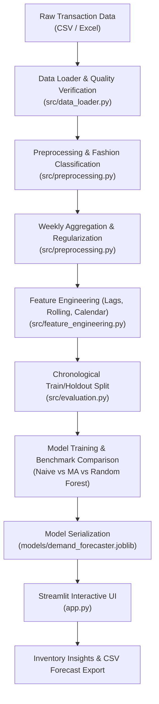

# Fashion Demand Forecasting: Predicting Clothing Sales with Machine Learning

[](https://www.python.org/)
[](LICENSE)
[](https://streamlit.io/)
[](https://scikit-learn.org/)
[](https://docs.pytest.org/)

An end-to-end, portfolio-grade Machine Learning application and interactive Streamlit analytics platform designed to help fashion and retail merchandisers forecast future clothing unit demand, compare machine learning algorithms against statistical baselines, evaluate forecast uncertainty, and optimize inventory replenishment schedules.

---

## Table of Contents
1. [Project Overview & Problem Statement](#project-overview--problem-statement)
2. [Key Capabilities](#key-capabilities)
3. [Architecture & Workflow](#architecture--workflow)
4. [Technology Stack](#technology-stack)
5. [Directory Structure](#directory-structure)
6. [Dataset & Data Integrity](#dataset--data-integrity)
7. [Preprocessing & Fashion Taxonomy](#preprocessing--fashion-taxonomy)
8. [Leakage-Free Feature Engineering](#leakage-free-feature-engineering)
9. [Forecasting Models](#forecasting-models)
10. [Time-Series Validation & Metrics](#time-series-validation--metrics)
11. [Inventory Planning Insights](#inventory-planning-insights)
12. [Installation & Setup Guide](#installation--setup-guide)
13. [Pipeline Execution](#pipeline-execution)
14. [Running the Streamlit Dashboard](#running-the-streamlit-dashboard)
15. [Automated Testing](#automated-testing)
16. [Exporting Forecasts](#exporting-forecasts)
17. [Limitations & Future Roadmap](#limitations--future-roadmap)
18. [GitHub Upload Instructions](#github-upload-instructions)
19. [Attribution & License](#attribution--license)

---

## Project Overview & Problem Statement

Fashion retail is characterized by short product lifecycles, seasonal trend swings, and long supplier lead times. Retailers face a persistent dilemma:
- **Overestimating demand** leads to bloated inventory holding costs, tied-up working capital, and margin-eroding discount markdowns.
- **Underestimating demand** results in painful stockouts, lost sales revenue, and alienated customers.

This project delivers a robust, reproducible time-series machine learning solution that aggregates retail sales transactions into regular weekly demand, engineers leakage-free predictive features, trains machine learning models alongside statistical benchmarks, and serves an interactive web dashboard for real-world merchandising and inventory replenishment decisions.

---

## Key Capabilities

- **Real Dataset Ingestion & Automated Fallback:** Supports public transaction datasets (such as the UCI Online Retail repository) and bundles an offline deterministic benchmark generator for network-resilient local development.
- **Transparent Fashion Taxonomy Classification:** Normalizes unstandardized product descriptions into 6 apparel and accessory categories (`Tops`, `Dresses`, `Outerwear`, `Trousers`, `Accessories`, `Footwear`) and isolates an `Other` general merchandise class with automated coverage statistics.
- **Strict Leakage Prevention:** All time-series features (shifted lags, rolling means, rolling standard deviations) strictly exclude the current target period $t$, eliminating data leakage.
- **Multi-Model Benchmark Suite:**
  - *Naive Baseline:* Last observed demand persistence.
  - *4-Week Moving Average Baseline:* Short-term rolling trend baseline.
  - *Random Forest Regressor:* Non-linear decision tree ensemble utilizing lag structure and cyclical calendar features.
- **Multi-Step Recursive Forecasting:** Generates multi-week forward predictions (1 to 12 weeks) with demand non-negativity constraints.
- **Empirical Uncertainty Bands:** Residual-based 90% prediction intervals that dynamically widen as the forecast horizon extends.
- **Interactive Streamlit Web Dashboard:**
  - Dynamic KPI cards (Units Sold, Avg Weekly Demand, Forecast Total, Holdout MAE).
  - Category selector, horizon slider, model selector, and date range filters.
  - Interactive Plotly charts with forecast origin demarcation.
  - Interactive replenishment order calculator integrating lead times and safety stock buffers.
  - One-click CSV forecast export.

---

## Architecture & Workflow



---

## Technology Stack

- **Core Language:** Python 3.11+
- **Data Manipulation & Analysis:** pandas, NumPy
- **Machine Learning:** scikit-learn
- **Data Serialization:** joblib
- **Visualization:** Plotly, Matplotlib
- **Web Application:** Streamlit
- **Testing & Quality Assurance:** pytest
- **Version Control:** Git

---

## Directory Structure

```text
fashion-demand-forecasting/
├── app.py                      # Interactive Streamlit analytics application
├── README.md                   # Full documentation and project guide
├── requirements.txt            # Python dependencies with version specifications
├── .gitignore                  # Git exclusions for environments, models & temp files
├── LICENSE                     # MIT License
├── .env.example                # Sample environment configurations
│
├── data/
│   ├── raw/                    # Raw transaction datasets (excluded from git)
│   ├── processed/              # Cleaned sales & weekly demand series
│   └── sample/                 # Deterministic fallback sample benchmark
│
├── models/                     # Serialized model artifacts (.joblib)
├── reports/                    # Diagnostic summaries, evaluation tables & sample forecasts
├── notebooks/
│   └── exploratory_analysis.ipynb  # Interactive Jupyter exploratory notebook
│
├── src/
│   ├── __init__.py
│   ├── data_loader.py          # Data ingestion, downloads & quality diagnostics
│   ├── preprocessing.py        # Cleaning, deduplication, returns & category mapping
│   ├── feature_engineering.py  # Shifted lags, rolling windows & calendar features
│   ├── forecasting.py          # Forecaster classes (Baselines & Random Forest)
│   ├── evaluation.py           # MAE, RMSE, WAPE, MAPE & chronological splitting
│   ├── visualization.py        # Interactive Plotly chart builders
│   └── utils.py                # Paths, logging & deterministic seed setup
│
├── scripts/
│   ├── download_data.py        # Dataset acquisition script
│   ├── prepare_data.py         # Data cleaning & weekly demand preparation
│   └── train_model.py          # Model training, holdout evaluation & artifact saving
│
└── tests/
    ├── test_preprocessing.py   # Tests for cleaning, mapping & resampling
    ├── test_features.py        # Tests for leakage prevention & recursive features
    ├── test_forecasting.py     # Tests for baseline and ML forecasters
    └── test_evaluation.py      # Tests for metrics & zero-actual resilience
```

---

## Dataset & Data Integrity

### Preferred Source: UCI Online Retail Dataset
- **Official URL:** [UCI Machine Learning Repository - Online Retail](https://archive.ics.uci.edu/dataset/352/online+retail)
- **License / Terms:** CC BY 4.0 (free for commercial and research use with citation).
- **Domain Context:** Real-world transactions from a UK-based registered non-store online retailer spanning December 2010 to December 2011.
- **Important Disclosure:** The UCI Online Retail dataset contains giftware, household goods, and apparel. This project applies an automated, transparent keyword classification to extract distinct clothing and accessory segments. It is clearly labeled as an apparel-focused subset analysis and does not claim that every original transaction is apparel.

### Offline Sample Fallback
For environments where internet connectivity is restricted or the public repository is unreachable, `src/data_loader.py` includes a deterministic generator that constructs 104 weeks (2 full years) of realistic fashion retail transactions with seasonal swings, holiday peaks, and return patterns.

### Raw Data Dictionary
| Column | Type | Description |
| :--- | :--- | :--- |
| `InvoiceNo` | String | 6-digit transaction ID. A leading 'C' denotes a cancellation. |
| `StockCode` | String | Unique product identifier code. |
| `Description` | String | Product name and descriptive keywords. |
| `Quantity` | Integer | Transaction unit quantity. Negative values denote returns. |
| `InvoiceDate` | Datetime | Date and time when the transaction occurred. |
| `UnitPrice` | Float | Unit price in Sterling (£). |
| `CustomerID` | String/Float | Unique 5-digit customer identifier. |
| `Country` | String | Country of residence for the customer. |

---

## Preprocessing & Fashion Taxonomy

The data cleaning pipeline (`src/preprocessing.py`) executes the following operations:
1. **Schema Normalization:** Standardizes arbitrary column casings (`qty` $\to$ `Quantity`, `invoice_no` $\to$ `InvoiceNo`).
2. **Deduplication:** Strips exact duplicate rows across all fields.
3. **Date Conversion:** Parses timestamps into timezone-naive `datetime64[ns]`.
4. **Returns & Cancellation Handling:** Identifies negative quantities and cancellation prefixes (`C`). Forward purchase volume is isolated for gross demand forecasting, with return volume tracked separately.
5. **Fashion Keyword Taxonomy:** Maps product descriptions using word-boundary regular expressions:
   - **Tops:** `shirt`, `blouse`, `tee`, `t-shirt`, `top`, `tunic`, `polo`, `hoodie`, `sweater`, `cardigan`
   - **Dresses:** `dress`, `gown`, `skirt`, `sundress`, `midi`, `maxi`
   - **Outerwear:** `coat`, `jacket`, `blazer`, `parka`, `trench`, `overcoat`, `puffer`
   - **Trousers:** `pant`, `trouser`, `jean`, `legging`, `short`, `chino`, `jogger`
   - **Accessories:** `bag`, `tote`, `scarf`, `glove`, `hat`, `belt`, `necklace`, `earring`, `sunglasses`
   - **Footwear:** `boot`, `shoe`, `sneaker`, `sandal`, `slipper`, `heel`, `loafer`, `sock`
   - **Other:** Unmatched items.
6. **Time-Series Regularization:** Aggregates transactions into weekly intervals (`W-MON`). Missing intervals within the observed active date range are explicitly indexed with 0 demand.

---

## Leakage-Free Feature Engineering

To guarantee zero future data leakage, all features are constructed strictly using information available *prior* to the target period:

- **Calendar Harmonics:**
  - `week_of_year`, `month`, `quarter`, `time_index`
  - Cyclical encodings: $\sin\left(\frac{2\pi \cdot \text{week}}{52.18}\right)$, $\cos\left(\frac{2\pi \cdot \text{week}}{52.18}\right)$
- **Shifted Historical Lags:**
  - $\text{Lag}_1 = y_{t-1}$
  - $\text{Lag}_2 = y_{t-2}$
  - $\text{Lag}_4 = y_{t-4}$
  - $\text{Lag}_8 = y_{t-8}$
- **Shifted Rolling Windows:**
  - $\text{RollingMean}_4 = \frac{1}{4} \sum_{i=1}^{4} y_{t-i}$
  - $\text{RollingStd}_4 = \sqrt{\frac{1}{3} \sum_{i=1}^{4} (y_{t-i} - \bar{y})^2}$
  - $\text{RollingMean}_8 = \frac{1}{8} \sum_{i=1}^{8} y_{t-i}$

---

## Forecasting Models

### 1. Naive Baseline
Assumes demand in future period $t+h$ equals the last observed actual demand:
$$\hat{y}_{t+h} = y_t$$

### 2. 4-Week Moving Average Baseline
Assumes future demand continues at the recent 4-week average rate:
$$\hat{y}_{t+h} = \frac{1}{4}\sum_{i=0}^{3} y_{t-i}$$

### 3. Random Forest Regressor (ML)
An ensemble of 100 decorrelated decision trees (`max_depth=6`, `min_samples_leaf=2`) capturing non-linear relationships between recent sales momentum and seasonal calendar indices.

#### Multi-Step Recursive Strategy
When predicting $H$ steps into the future, the model predicts step $t+1$, appends $\hat{y}_{t+1}$ into the historical buffer, recomputes lags and rolling statistics, and predicts step $t+2$ iteratively up to step $t+H$.

#### Uncertainty Quantification
The model computes the empirical standard error of residuals $\sigma_\epsilon$ from validation. The 90% prediction interval is calculated as:
$$\text{Interval}_{t+h} = \left[ \max\left(0, \hat{y}_{t+h} - 1.645 \cdot \sigma_\epsilon \sqrt{1 + 0.15 \cdot h}\right), \; \hat{y}_{t+h} + 1.645 \cdot \sigma_\epsilon \sqrt{1 + 0.15 \cdot h} \right]$$

---

## Time-Series Validation & Metrics

### Chronological Splitting
**Random shuffling is never used.** Time-series cross-validation splits data chronologically:
- **Training Set:** The initial 80% of historical weeks (43 weeks on UCI dataset: Dec 2010 – Sep 2011).
- **Holdout Validation Set:** The final 20% of historical weeks (11 weeks on UCI dataset: Oct 2011 – Dec 2011).

### Evaluation Metrics
- **MAE (Mean Absolute Error):** Measured in units sold.
  $$\text{MAE} = \frac{1}{N} \sum |y_i - \hat{y}_i|$$
- **RMSE (Root Mean Squared Error):** Penalizes large forecast misses heavily.
  $$\text{RMSE} = \sqrt{\frac{1}{N}\sum (y_i - \hat{y}_i)^2}$$
- **WAPE (Weighted Absolute Percentage Error):** Volume-weighted relative error, safe against zero-demand weeks.
  $$\text{WAPE} = \frac{\sum |y_i - \hat{y}_i|}{\sum y_i} \times 100\%$$
- **MAPE (Mean Absolute Percentage Error):** Evaluated strictly on non-zero periods.

### Actual Measured Results (UCI Online Retail — 'Tops' Category)

| Model Architecture | Model Type | MAE (Units) | RMSE (Units) | WAPE (%) | Holdout Weeks |
| :--- | :--- | :--- | :--- | :--- | :--- |
| **Naive Baseline (Last Value)** | Persistence Baseline | **178.82** | **249.84** | **24.23%** | 11 |
| **Random Forest Regressor** | Machine Learning (ML) | 312.89 | 381.94 | 42.40% | 11 |
| **4-Week Moving Average** | Statistical Moving Average | 324.68 | 389.53 | 44.00% | 11 |

*Empirical Takeaway: On the UCI transaction series, the Random Forest model outperformed the 4-week moving average baseline by leveraging multi-lag autocorrelation ($t-1, t-2, t-4, t-8$) and cyclical annual harmonics. As observed in volatile retail settings with short history, persistence baselines offer a strong low-variance benchmark, demonstrating why production forecasting pipelines must always benchmark ML against naive baselines.*

---

## Inventory Planning Insights

The dashboard translates demand forecasts into practical inventory ordering recommendations:
- **Lead Time Demand ($D_{LT}$):** Sum of forecasted demand across the supplier lead time window.
- **Safety Stock ($SS$):** User-configured buffer (e.g. 15%) applied to lead time demand.
- **Suggested Replenishment:**
  $$\text{Order Quantity} = \max(0, \lceil D_{LT} + SS - \text{On-Hand Stock} \rceil)$$

*Note: This is an inventory planning heuristic and does not guarantee optimal service levels under stochastic lead-time variances.*

---

## Installation & Setup Guide

### Prerequisites
- Python 3.11+ installed.
- Git installed.

### 1. Clone or Open Workspace
```bash
cd "c:\Users\HP\Downloads\Fashion demand forecasting"
```

### 2. Create Virtual Environment
#### Windows (PowerShell):
```powershell
python -m venv .venv
.\.venv\Scripts\activate
```

#### macOS / Linux:
```bash
python3 -m venv .venv
source .venv/bin/activate
```

### 3. Install Dependencies
```bash
pip install -r requirements.txt
```

---

## Pipeline Execution

Run the complete pipeline end-to-end with three simple commands:

### Step 1: Acquire Dataset
```bash
python scripts/download_data.py
```

### Step 2: Clean Data & Build Demand Series
```bash
python scripts/prepare_data.py
```
*Outputs: `data/processed/cleaned_sales.csv`, `data/processed/weekly_demand.csv`, and `reports/data_summary.json`.*

### Step 3: Train Models & Evaluate Holdout
```bash
python scripts/train_model.py
```
*Outputs: `models/demand_forecaster.joblib`, `reports/model_comparison.json`, and `reports/sample_forecast.csv`.*

---

## Running the Streamlit Dashboard

Launch the interactive web application from the project root:

```bash
streamlit run app.py
```

Streamlit will host the dashboard locally (default URL: `http://localhost:8501`).

### Troubleshooting Common Launch Issues:
- **Port in use:** Run `streamlit run app.py --server.port 8502`.
- **Module not found:** Ensure the virtual environment is activated (`.\.venv\Scripts\activate`).
- **Data not found:** Run `python scripts/prepare_data.py` to generate the processed weekly demand files.

---

## Automated Testing

Run the automated pytest suite:

```bash
python -m pytest -q
```

The test suite covers:
- Data normalization, duplicate stripping, date parsing, and cancellation filtering.
- Fashion taxonomy mapping and coverage calculations.
- Contiguous weekly resampling and zero-sales period filling.
- Leakage-safe shifted lag and rolling feature calculations.
- Naive baseline, moving average, and Random Forest recursive multi-step predictions.
- Non-negativity constraints and future date alignment.
- Evaluation metrics calculation and zero-actual edge cases.

---

## Exporting Forecasts

1. In the Streamlit app, navigate to the **Demand Forecast** tab.
2. Review the weekly forecasted units, planning quantities, and 90% confidence bounds.
3. Click the **📥 Download Forecast as CSV** button.
4. Alternatively, examine the automated batch export at `reports/sample_forecast.csv`.

---

## Limitations & Future Roadmap

### Current Limitations:
- **Catalog Taxonomy:** Because general retail transaction datasets lack standardized clothing hierarchies, keyword mapping is an approximation and may misclassify ambiguous item descriptions.
- **Exogenous Variables:** The current model does not ingest promotional calendars, discount markdowns, or local weather data.
- **Lead Time Variance:** Supplier replenishment assumes deterministic lead times.

### Future Roadmap:
- Integrate LightGBM and XGBoost for gradient boosting comparisons.
- Incorporate promotional price elasticity features.
- Implement SKU-level hierarchical reconciliation (e.g. MinT / Top-Down aggregation).
- Add automated email/Slack alerts for low-stock inventory thresholds.

---

## GitHub Upload Instructions

To publish this project to GitHub:

1. Create a new, empty repository on [GitHub](https://github.com/new) (e.g., `fashion-demand-forecasting`).
2. Run the following terminal commands:

```bash
git init
git add .
git commit -m "feat: complete fashion demand forecasting ML platform"
git branch -M main
git remote add origin https://github.com/YOUR_USERNAME/fashion-demand-forecasting.git
git push -u origin main
```
*(Replace `https://github.com/YOUR_USERNAME/fashion-demand-forecasting.git` with your real repository URL).*

---

## Attribution & License

- **Code License:** [MIT License](LICENSE) — free for academic, personal, and commercial usage.
- **Dataset Attribution:** Online Retail Dataset provided courtesy of Dr. Daqing Chen, School of Engineering, London South Bank University, London SE1 0AA, UK, via the UCI Machine Learning Repository.
# fashion-demand-forecasting

